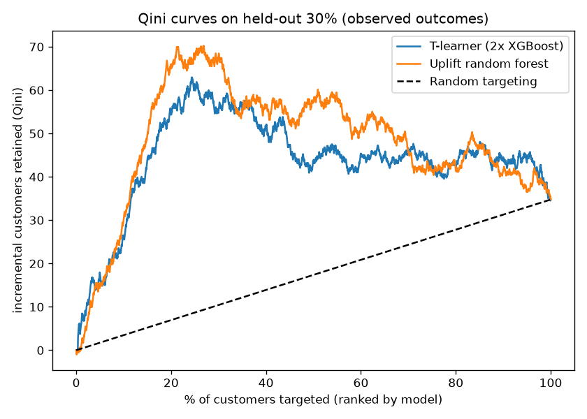
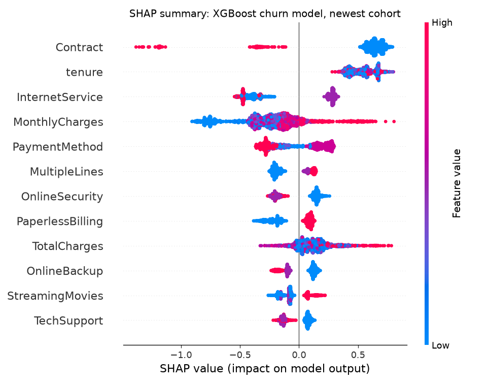
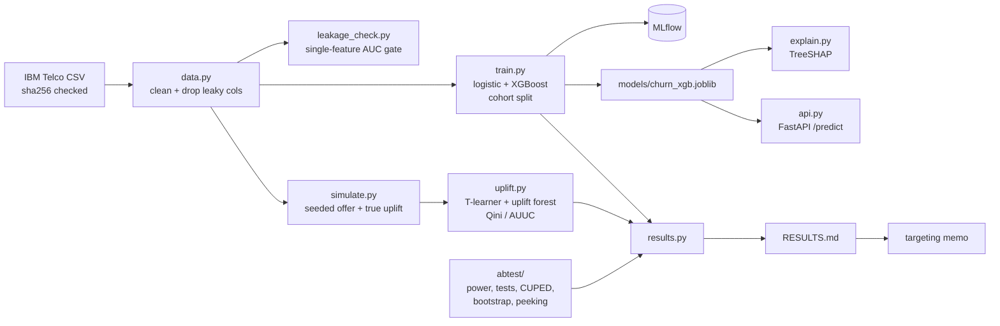

# Churn and Uplift Lab

Churn prediction with leakage-safe evaluation, uplift models that find who a retention
offer actually changes, a tested A/B toolkit, and a served model.

[](https://github.com/abhiramvedipala/churn-uplift-lab/actions/workflows/ci.yml)

## Problem

A telecom retention team has a discount budget and a list of customers likely to leave.
The usual approach sends offers to the highest-risk customers. But many of them leave no
matter what, some would have stayed anyway, and some are pushed *out* by the reminder.
This project answers the question the team actually has: **who should get the offer?**
It also builds the tools to check the answer with a proper experiment.

## Demo

| Qini curves: uplift models vs random | SHAP drivers of churn |
|---|---|
|  |  |

```bash
curl -s -X POST localhost:8000/predict -H 'content-type: application/json' -d @- <<'EOF'
{"tenure": 3, "MonthlyCharges": 89.5, "TotalCharges": 268.5, "gender": "Female",
 "SeniorCitizen": "No", "Partner": "No", "Dependents": "No", "PhoneService": "Yes",
 "MultipleLines": "Yes", "InternetService": "Fiber optic", "OnlineSecurity": "No",
 "OnlineBackup": "No", "DeviceProtection": "No", "TechSupport": "No",
 "StreamingTV": "Yes", "StreamingMovies": "Yes", "Contract": "Month-to-month",
 "PaperlessBilling": "Yes", "PaymentMethod": "Electronic check"}
EOF
# {"churn_probability":0.7569,"decile":10,"top_drivers":[{"feature":"Contract",
#   "value":"Month-to-month","shap":0.7043,"direction":"raises churn risk"}, ...]}
```

Other outputs: [calibration plot](docs/calibration.png),
[per-customer explanations](docs/customer-explanations.md),
[uplift drivers](docs/uplift_shap.png), [targeting memo](docs/targeting-memo.md).

## Architecture



The CSV is downloaded and hash-checked, cleaned, and passed through a leakage gate.
Two churn models train on older signup cohorts and are scored on the newest one. The
XGBoost pipeline is saved and served with per-prediction SHAP drivers. Separately, a
seeded simulation adds a randomized retention offer with known per-customer effects,
and two uplift models are scored against that truth. `results.py` collects every
metric into RESULTS.md, and the memo quotes only those numbers.

## Tech stack

| Tool | Used for | Why I chose it |
|---|---|---|
| pandas, NumPy, SciPy | data, stats formulas | standard and fast enough at 7k rows |
| scikit-learn | pipelines, logistic regression, metrics | encoding is fit inside the pipeline, so it can't leak |
| XGBoost | churn model, T-learner | strong on tabular data; built-in exact TreeSHAP |
| causalml | uplift random forest, Qini/AUUC | maintained uplift trees with KL splitting |
| shap | summary plots | standard beeswarm view; plots only, not used at serve time |
| MLflow | run tracking | local SQLite store, no server to run |
| FastAPI + Pydantic | serving and validation | typed schema gives 422s and OpenAPI docs for free |
| statsmodels | reference values in tests | independent check of my power/test code |
| Docker, GitHub Actions | packaging, CI | one image to serve; every push reruns all numbers |
| ruff, pytest | lint, tests | fast, one config in pyproject |

## Quick start

Prerequisites: Python 3.12, [uv](https://docs.astral.sh/uv/), Docker (optional).

```bash
uv venv --python 3.12 .venv && uv pip install --python .venv -e ".[lab,dev]" && scripts/check.sh
```

That one line downloads the data, runs the leakage gate, trains, explains, simulates,
fits the uplift models, runs all tests and rewrites RESULTS.md (about 40 s). To serve:

```bash
.venv/bin/uvicorn churnlab.api:app --port 8000
```

```bash
docker build -t churn-api . && docker run -p 8000:8000 churn-api
```

## Results

From [RESULTS.md](RESULTS.md); regenerate with `scripts/check.sh`.

**Churn** (test = newest cohort, tenure < 12 months, n=2,069, 48.3% churn). Command: `python -m churnlab.train`

| Split | Model | AUC-PR | AUC-ROC | Top-decile lift |
|---|---|---|---|---|
| cohort (leakage-safe) | logistic | 0.746 | 0.774 | 1.72x |
| cohort (leakage-safe) | XGBoost | 0.728 | 0.763 | 1.68x |
| random (comparison) | logistic | 0.661 | 0.840 | 2.93x |
| random (comparison) | XGBoost | 0.663 | 0.844 | 3.00x |

**Uplift** (simulated offer, held-out 30%, n=2,113). Command: `python -m churnlab.uplift`

| Targeting | Qini | True uplift captured, top 20% (share of oracle) | Customers kept, offers to 20% of base |
|---|---|---|---|
| Uplift random forest | 0.875 | 91.9% | 354 |
| T-learner (2x XGBoost) | 0.761 | 81.8% | 315 |
| Churn risk | - | 45.2% | 174 |
| Random | - | 26.6% | 102 |

**A/B toolkit.** Commands: `pytest tests/test_abtest.py`, `python -m churnlab.results`

| What | Value |
|---|---|
| Unit tests against known results | 20 |
| Customers per arm, churn 26.5% → 23.5% | 3,268 |
| False-positive rate with 10 peeks (nominal 5%) | 19.4% |

## How it works

**Leakage-safe split and gate.** Tenure stands in for signup date, so the newest year of
customers is the test set. `leakage_check.py` scores each feature alone out of sample
(target-rate encoding fit on train) and fails the build above 0.80 AUC. The best real
feature is 0.72. Tests inject an outcome copy and a noisy churn score to prove the gate
catches them.

**SHAP without shap at serve time.** `explain.py` calls XGBoost's
`pred_contribs=True`, which is exact TreeSHAP, and sums one-hot columns back to raw
features. Because SHAP is additive, the grouped values plus the base value reproduce the
model's output (tested to 1e-5). The API returns the top three.

**An honest simulated experiment.** `simulate.py` uses out-of-fold churn probabilities as
a realistic baseline, assigns the offer 50/50, and applies documented segment effects:
persuadables, sleeping dogs (two-year contracts, negative effect) and lost causes (fiber
+ electronic check, zero effect). Because the true uplift is saved, "how much real
uplift did the model find?" is a measurable number.

**Why lost causes matter.** Without them, uplift is proportional to risk, and risk
targeting gets 94.7% of the oracle on its own. With them, it gets 45% and the uplift
forest 92%. Both versions are in git; see DECISIONS.md.

**A/B toolkit.** `abtest/` implements the power, z, Welch, CUPED, bootstrap and peeking
calculations from their formulas. The tests compare them to Cohen's tables, statsmodels,
scipy and Armitage et al. (1969), so the references are independent of the code.

## Testing

```bash
.venv/bin/pytest -q
```

57 tests: data and leakage gate (5), churn metrics and SHAP additivity (6), simulation
and uplift (5), A/B toolkit against known results (20), API (21). API tests need a
trained model, so run `python -m churnlab.train` first (`scripts/check.sh` does).

## Design decisions and trade-offs

Full list in [DECISIONS.md](DECISIONS.md). The top three:

1. **Cohort split over random.** It is harsher: AUC-ROC 0.76 vs 0.84. But it is the
   number to expect on new customers. AUC-PR looks *better* on the cohort split only
   because its base rate is higher, so I compare splits on AUC-ROC and lift.
2. **Logistic wins, I still serve XGBoost.** Logistic is ahead on every cohort metric
   by about 0.01-0.02. I kept XGBoost for exact per-customer TreeSHAP drivers. Switching
   is the first thing I'd revisit.
3. **Simulate the treatment, and say so.** There's no treatment in Telco, so the offer is
   simulated with saved ground truth. The memo says plainly that its numbers measure the
   method, not a real campaign.

## Known limits and next steps

- The uplift numbers come from a simulated offer. The next step is a randomized pilot,
  sized with the toolkit (3,268 per arm).
- Probabilities are miscalibrated on the newest cohort because of prior shift (train
  17.5% churn, test 48%). Recalibrating on recent data would fix that.
- Tenure is only a stand-in for time. Real snapshot dates would allow a true
  backtest.
- The Docker image is 1.7 GB because the Linux xgboost wheel bundles NCCL;
  `xgboost-cpu` would shrink it.
- The bootstrap is percentile-only; BCa would help for heavily skewed metrics.

## Project structure

```
churnlab/            churn + uplift + serving
  data.py            download (sha256), clean, leaky columns, splits
  leakage_check.py   single-feature AUC gate
  train.py           logistic + XGBoost, metrics, MLflow, calibration
  explain.py         TreeSHAP drivers, summary plot, customer report
  simulate.py        seeded synthetic retention offer
  uplift.py          T-learner, uplift forest, Qini/AUUC, budgets
  api.py             FastAPI /predict
  results.py         builds RESULTS.md
abtest/              power.py, inference.py (z, Welch, CUPED, bootstrap), sequential.py
tests/               57 tests
scripts/check.sh     lint + regenerate + test
docs/                plots, explanations, memo, interview notes
reports/metrics/     JSON metrics behind RESULTS.md
Dockerfile, .github/workflows/ci.yml
```
